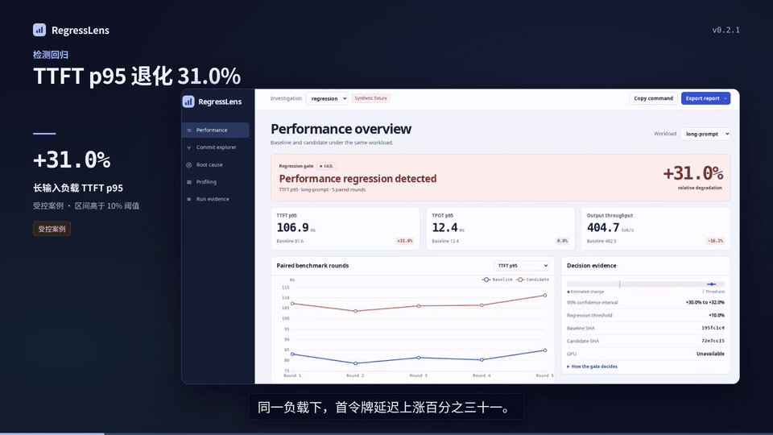

# RegressLens

基于实验数据定位 LLM 推理性能回归。输入两个 Git 版本和同一份工作负载，得到回归判定、可疑提交范围、诊断证据和独立对照实验记录。

[4 分钟参赛演示](https://devinhuang2001.github.io/RegressLens/#video) · [在线交互 Demo](https://devinhuang2001.github.io/RegressLens/report.html) · [项目简介](docs/SUBMISSION.md) · [完整展示包](docs/downloads/RegressLens-Showcase-Kit.zip)



## 快速试用

需要 Linux 或 macOS、Python 3.11+ 和 Git。发行包内含构建好的 Dashboard。

```sh
python -m venv .venv
source .venv/bin/activate
python -m pip install -e '.[test]'
python demo/fixture.py --out .regresslens/demo
regresslens --store .regresslens/demo/store serve
```

打开 `http://127.0.0.1:8765`。也可以离线打开 `.regresslens/demo/regression.html`。四个案例由本地 Git 生成器创建，重复演示时指定新的输出目录。

| 案例 | 主要结果 |
|---|---|
| regression | 检测到 +31.0% TTFT p95，跳过模拟构建失败，定位到调度变更，独立回退得到 SUPPORTED |
| stable | PASS，未进入二分 |
| noisy | INCONCLUSIVE，区间跨过退化阈值 |
| environment | INVALID，环境证据阻止源码归因 |

Dashboard 提供性能总览、提交定位、根因调查、Profiling 和实验记录五个视图。性能总览展示退化阈值及区间。提交定位支持按状态筛选和查看单个提交的决策。根因调查可以从指标跳到原始实验。HTML 可离线打开并导出 Markdown 和 JSON。

[提交定位截图](preview/RegressLens-Commit-Explorer.png) · [根因调查截图](preview/RegressLens-Root-Cause.png) · [实验记录截图](preview/RegressLens-Run-Evidence.png)

## 用真实 vLLM 运行

### Colab T4

打开 **RegressLens-Colab.ipynb**。Notebook 内含项目源码并校验包摘要。先运行受控 Git 案例，再运行真实 GPU 对照。

真实对照固定 vLLM、模型和 Tokenizer，并通过九个提交将 `max_num_seqs` 从 8 调整为 1。该变更是人为注入的调度限制。实验使用实际 GPU 负载，可在同一个运行时执行二分和独立回退。每边三轮适合试用，五轮或更高适合追加复验。期望现象是并发排队增加，判定以实测区间为准。

### 自己的源码历史

先在候选范围内准备已审查的构建和启动包装脚本。构建、启动和运行时探测的工作目录均为对应的 detached worktree。启动脚本需要加载该 worktree 构建产物，并固定模型与 Tokenizer revision。构建产物和虚拟环境可放在对应 worktree 下，避免版本间复用安装状态。复制并修改 [configs/vllm.example.yaml](configs/vllm.example.yaml)。

```sh
python -m pip install -e '.[benchmark,test]'
regresslens investigate --repo /path/to/vllm --good GOOD_SHA --bad BAD_SHA \
  --config experiment.yaml --id scheduler-check --trusted-repo
regresslens diagnose --investigation scheduler-check
regresslens report --investigation scheduler-check --format html --out report.html
```

对照验证需要明确选择假设和完整提交 SHA。命令在一次性 worktree 回退指定提交，重新测量 `Good ↔ Reverted` 与 `Bad ↔ Reverted`。如果两组对照分别说明回退后低于退化阈值、相对 Bad 的改善区间完全小于零，则记录 `SUPPORTED`。

```sh
regresslens verify --investigation scheduler-check --hypothesis RCA-001 \
  --revert SUSPECT_SHA --trusted-repo
regresslens resume --investigation scheduler-check --trusted-repo
```

运行预算耗尽时保留已完成轮次，`resume` 读取同一调查剩余步骤。执行中的回退实验可用同一条 `verify` 命令恢复。

### 测量已启动的本地服务

```sh
regresslens benchmark --config experiment.yaml --target http://127.0.0.1:8000 --out baseline
regresslens benchmark --config experiment.yaml --target http://127.0.0.1:8000 --out candidate
regresslens compare --config experiment.yaml \
  --baseline baseline/experiments.json --candidate candidate/experiments.json
```

单独运行时，部署顺序和服务版本由操作者控制。需要自动交替、构建和二分时使用 `investigate`。配置中可声明多个固定 token 长度和并发度的合成负载。

## 判定方法和边界

- 每组按相同种子配对，交替执行 AB / BA。对每对测量的相对退化取均值，再按对重采样。正值表示变慢或吞吐下降。
- 区间整体达到阈值时为 FAIL，整体低于阈值时为 PASS，跨阈值或样本缺失时为 INCONCLUSIVE。环境漂移或测试失败率超限为 INVALID。
- 只有预先指定的 workload + metric 决定二分方向。其他指标的区间用于解释。少量配对的 Bootstrap 区间对分布尾部敏感，赛事实测应保留重复运行明细。
- 二分在 first-parent 历史上运行，依赖阈值只被持续跨越一次的假设。失败、跳过或不确定的版本留在证据路径中。输出区间时保留候选范围。
- TTFT、TPOT 和 ITL 直接读取 GuideLLM 0.8.1 的统计口径。E2E 从秒转换为毫秒。前端展示每轮分位数的均值和原始轮次引用。Prometheus 在测量边界采集，耗时独立记录。
- 当前运行器接受指定本地回环地址与经审查的本地源码。API 任务创建限预置夹具；真实构建由本地 CLI 明确启动。处理第三方源码时由操作者在独立容器或 VM 内执行，给构建配置资源与权限边界。P0 未提供自动容器调度。
- 重型 GPU Profiling、外部数据集导入、GitHub CI 触发与多节点编排属于后续工作。

## 开发和验收

```sh
python -m pytest -q
cd frontend
npm ci
npm run build
```

根目录的 `tests/` 覆盖统计、GuideLLM schema、Prometheus、提交定位、回退、可恢复执行和本地 API。前端构建输出到 Python 包的 `web/`，支持 API 和独立 HTML 两种入口。

相关接口依据 [GuideLLM 0.8.1 文档](https://vllm-project.github.io/guidellm/0.8.1/)、[vLLM 指标文档](https://docs.vllm.ai/en/stable/usage/metrics/) 和 [vLLM 0.13.0 GPU 安装文档](https://docs.vllm.ai/en/v0.13.0/getting_started/installation/gpu/)。许可证位于 `LICENSE` 和 `third_party/`。

## Trace 与火焰图

Dashboard 的 **Profiling** 页面提供 Good / Bad 时间轴、CPU 差分火焰图和 GPU kernel 明细。根因页链接到同一份 Profiling 证据，HTML 可离线打开。

[Trace 时间轴截图](preview/RegressLens-Trace-Timeline.png) · [CPU 差分火焰图截图](preview/RegressLens-Flame-Graph.png)

### 先看受控案例

```sh
python demo/profiling_fixture.py --out .regresslens/profiling-demo
```

打开 `.regresslens/profiling-demo/regression.html`。示例的 GPU span 和 CPU 栈都是受控输入。

### 导入已有产物

```sh
regresslens profile attach --investigation scheduler-check \
  --good-trace good.pt.trace.json.gz --bad-trace bad.pt.trace.json.gz \
  --good-stacks good.speedscope.json --bad-stacks bad.speedscope.json

regresslens report --investigation scheduler-check --format html --out profiling.html
```

Chrome Trace 支持普通 JSON 和 gzip JSON。可单独导入 Trace 或 Speedscope 的一对产物。可用 `--bad-commit` 把比较关联到已定位的提交，并用 `--scenario` 指定现有工作负载。手动导入时，Good / Bad 的采集版本、负载和时钟由操作者核对。原文件保存在调查的 `profiles/` 中，可从本地 Dashboard 下载后在 Perfetto 或 Speedscope 中打开。

CPU 图优先使用 Speedscope 的样本权重。两侧只有 Torch Trace 时，如果存在可嵌套的 `python_function` spans，会按线程合计 Python span 时间生成火焰图。差分颜色表示两版调用栈占比的百分点变化。GPU kernel 的累计耗时与单次耗时独立比较。

### 单独采集 vLLM

```sh
regresslens profile capture --investigation scheduler-check --trusted-repo --requests 16
```

此命令复用受信任本地 worktree、构建脚本和调查负载。启动脚本需把命令行追加参数转交给支持 `--profiler-config` 的 vLLM 服务。默认比较已定位的首个失败提交和 Good，允许用 `--bad-commit` 覆盖。默认导入第 1 个 worker Trace，可用 `--trace-index`（从 0 开始）选择。每轮都会尝试停止 Profiler 并等待 Trace 写入。采集日志和其他 worker Trace 也会保留。本命令把 Profiling 附到报告，原 Benchmark 数据继续用于回归判定。

## 让 AI 或 CI 直接调用 CLI

能够运行终端命令的 Agent 可以直接调用 CLI。安装后先运行 `regresslens --json capabilities` 发现命令，再用 `regresslens <命令> --help` 查参数。有需要时通过 `regresslens serve` 启动本地 Dashboard。

| 工作 | CLI 入口 |
|---|---|
| 建立调查、回归检测、Git 二分、继续执行 | `create`、`investigate`、`bisect`、`resume` |
| 单独压测和比对 | `benchmark`、`compare` |
| 查列表与进度 | `list`、`status` |
| 查指标、提交、假设、轮次、验证、Profiling 与配置 | `inspect --section ...`、`diagnose` |
| 登记验证与执行隔离回退 | `request-verification`、`verify` |
| 导入或采集 Trace 和 CPU 栈 | `profile attach`、`profile capture` |
| 导出原始 Trace、日志、源码差异和报告 | `artifact list`、`artifact export`、`report` |

```sh
python demo/profiling_fixture.py --out .regresslens/agent-demo
regresslens --json --store .regresslens/agent-demo/store status --investigation regression
regresslens --json --store .regresslens/agent-demo/store inspect --investigation regression --section profiling
regresslens --json --store .regresslens/agent-demo/store report --investigation regression --format html --out report.html
```

全局选项 `--json` 和 `--store` 放在命令之前。有限命令在 `--json` 下把一个 JSON 对象写到 stdout，字段为 `schema_version`、`command`、`ok`、`result`、`error`。进度消息写到 stderr。可读取 `error.code` 与 `error.message` 处理命令错误。

Agent 应同时读取 `result.state` 和 `result.gate.decision`。例如，调查成功完成并确认性能回归时，`ok=true` 且 `gate.decision="FAIL"`。保留 `INCONCLUSIVE`、`INVALID` 和 `PARTIAL` 的含义，只有隔离验证返回 `SUPPORTED` 时才记录假设得到实验支持。

以下代码使用参数数组调用工具。启动仓库构建脚本仍需显式传入 `--trusted-repo`。

```python
import json
import subprocess

reply = subprocess.run(
    ["regresslens", "--json", "--store", ".regresslens/agent-demo/store",
     "status", "--investigation", "regression"],
    capture_output=True, text=True,
)
response = json.loads(reply.stdout)
if not response["ok"]:
    raise RuntimeError(response["error"]["message"])
print(response["result"]["gate"]["decision"])
```
